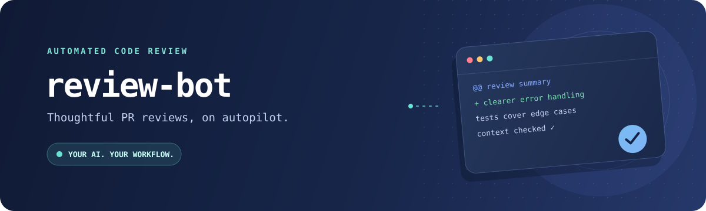

<div align="center">
  

  <p><strong>Your AI reviewer, right where your team works.</strong></p>
  <p>Automatically review requested pull requests, with repository context and a provider you choose.</p>
</div>

---

[](https://github.com/steveswinsburg/review-bot/actions/workflows/ci.yml)

## What it does

Review Bot is a small Python script built to run on a schedule. It finds open pull requests in a GitHub organization or personal account that have been assigned to you for review, or that you authored, asks an AI provider to review the changes, and posts the result as a pull request comment.

- **Fits your workflow:** runs as a single process, once per invocation—cron-ready.
- **Understands the codebase:** checks out each PR into a temporary Git worktree, includes that repository's rules, and uses a digest of each sibling repository. The model can ask for specific files. Sibling file bodies are not pasted in up front.
- **Avoids duplicate reviews:** tracks each PR commit locally and in a hidden marker on GitHub, so new commits are reviewed while already-reviewed commits are skipped.
- **Choose where AI runs:** use local Ollama by default, or configure a compatible remote provider.

## How a review happens

`Find assigned or authored PRs` → `refresh stale sibling digests` → `check out the latest commit` → `review the diff, rules, and any files the model asks for` → `post a review comment`

A run with nothing to review does not build digests. The same configured provider writes the digests and the review. A digest is rebuilt only when its stored commit no longer matches that clone. The model may request files across several calls. A question is not posted. If 12 calls produce no review, that commit is left for the next run.

If a provider or network is temporarily unavailable, the run fails gracefully; the next scheduled run can try again. A failed digest is logged, and the review still runs with the diff, the pull request rules, and any sibling digests that are already fresh.

## Get started

### 1. Install

Install [`uv`](https://docs.astral.sh/uv/getting-started/installation/) if it
is not already available, then sync the runtime dependencies declared in
`pyproject.toml`. This creates the `.venv` environment:

```bash
uv sync
```

Run the bot with the environment managed by uv:

```bash
uv run python review_bot.py
```

Install and start [Ollama](https://ollama.com/) locally, then download the default model:

```bash
ollama pull llama3
```

### 2. Prepare your workspace

The workspace layout determines review scope, for both organizations and
personal accounts:

- **Single repository:** If `WORKSPACE_PATH` contains a `.git` directory or
  file, only that checkout is eligible for review. Sibling and nested
  repositories are not used for context.
- **Multiple repositories:** Otherwise, the bot selects Git clones directly
  inside `WORKSPACE_PATH`. Only those repositories are eligible for review.
  Each other clone can contribute a digest at
  `.review-bot/<repo>.md` in the workspace root. The review run rebuilds a
  sibling digest when that file is missing or its commit differs from the
  clone, before reviewing. Nested repositories and non-Git directories are
  ignored. `.review-bot` is not a repository.
- **No repositories:** The bot logs that there is nothing to review and exits
  successfully.

Put related projects together and keep unrelated projects in separate
workspaces to avoid sharing unrelated context. Directory locations are up to
you; the workspace path does not need to match the GitHub owner name. Name
each checkout after its GitHub repository so the bot can match PRs to clones.
`GITHUB_OWNER`/`GITHUB_ORG` only determines whose PRs are searched; PRs outside
the selected workspace repositories are ignored.

```text
~/code/review-workspace/       # WORKSPACE_PATH
├── .review-bot/
│   ├── service-one.md         # commit SHA, then exports, routes, and types
│   └── service-two.md
├── service-one/               # clone of your-org/service-one
└── service-two/               # clone of your-org/service-two
```

The pull request repository is read from its review worktree, including
`AGENTS.md`, `CLAUDE.md`, `CONTRIBUTING.md`, `ARCHITECTURE.md`, and
`.cursor/rules/`. Its own digest is not used as sibling context. Other
repositories are opened only when the model names a file as
`repo-name/relative/path`.

### 3. Configure and run

Set the required environment variables, then run the script. Set either
`GITHUB_OWNER` to the login of an organization or personal account (Review Bot
detects the account type), or set `GITHUB_ORG` when you know the owner is an
organization. No special organization-side installation or configuration is
needed. The token must be able to access the target repositories, and
`GITHUB_USER` must be the account that is requested for review, or the author of PRs you want the bot to review.

| Environment variable | When to set it | Example |
|---|---|---|
| `GITHUB_TOKEN` | Required. Personal access token with access to the target repositories and permission to read pull requests and post comments. | `GITHUB_TOKEN="github_pat_..."` |
| `GITHUB_USER` | Required. GitHub username the token belongs to. Used to find PRs assigned to that user for review, and PRs that user authored. | `GITHUB_USER="octocat"` |
| `GITHUB_OWNER` | Required if `GITHUB_ORG` is not set. Organization or personal-account login whose open PRs are searched; account type is detected automatically. | `GITHUB_OWNER="octocat"` or `GITHUB_OWNER="your-org"` |
| `GITHUB_ORG` | Required if `GITHUB_OWNER` is not set. Organization login whose open PRs are searched. | `GITHUB_ORG="your-org"` |
| `WORKSPACE_PATH` | Required. A single Git checkout or a parent directory containing selected Git clones. Both layouts work with an organization or personal account. | `WORKSPACE_PATH="$HOME/code/review-workspace"` or `WORKSPACE_PATH="$HOME/code/my-repo"` |
| `AI_PROVIDER` | Optional; defaults to `ollama`. Selects a provider config such as `ollama`, `openai`, `cursor`, or `anthropic`. | `AI_PROVIDER="openai"` |
| `AI_PROVIDER_CONFIG_DIR` | Optional; defaults to this project's `providers/` directory. Directory containing `<AI_PROVIDER>.json`. | `AI_PROVIDER_CONFIG_DIR="$HOME/review-bot/providers"` |
| `OLLAMA_URL` | Optional; defaults to `http://localhost:11434`. Overrides the Ollama endpoint. | `OLLAMA_URL="http://localhost:11434"` |
| `OLLAMA_MODEL` | Optional; defaults to `llama3`. Overrides the Ollama model name. | `OLLAMA_MODEL="llama3"` |
| `OPENAI_API_KEY` | Required when using the bundled `openai` provider. | `OPENAI_API_KEY="your-openai-api-key"` |
| `CURSOR_API_KEY` | Required when using the bundled `cursor` provider. | `CURSOR_API_KEY="your-cursor-api-key"` |
| `ANTHROPIC_API_KEY` | Required when using the bundled `anthropic` provider. | `ANTHROPIC_API_KEY="your-anthropic-api-key"` |

The default provider is local Ollama (`llama3` at `http://localhost:11434`).
For an organization, you can use either configuration:

```bash
GITHUB_TOKEN="your-token" \
GITHUB_USER="your-username" \
GITHUB_ORG="your-org" \
WORKSPACE_PATH="$HOME/code/review-workspace" \
uv run python review_bot.py
```

For repositories owned by a personal account, use `GITHUB_OWNER` with the
account's login. This example selects one checkout without sibling digests;
set `WORKSPACE_PATH="$HOME/code/review-workspace"` instead to review multiple
related clones and share those digests between them. Organizations can also
use the single-checkout layout:

```bash
GITHUB_TOKEN="your-token" \
GITHUB_USER="your-username" \
GITHUB_OWNER="your-username" \
WORKSPACE_PATH="$HOME/code/my-repo" \
uv run python review_bot.py
```

To override the Ollama model:
```bash
GITHUB_TOKEN="your-token" \
GITHUB_USER="your-username" \
GITHUB_ORG="your-org" \
OLLAMA_MODEL="llama3" \
WORKSPACE_PATH="$HOME/code/review-workspace" \
uv run python review_bot.py
```

For a remote provider, set its selector and API key as well. For example:

```bash
GITHUB_TOKEN="your-token" \
GITHUB_USER="your-username" \
GITHUB_OWNER="your-org" \
WORKSPACE_PATH="$HOME/code/review-workspace" \
AI_PROVIDER="openai" \
OPENAI_API_KEY="your-openai-api-key" \
uv run python review_bot.py
```

## Run it on a schedule

For hourly reviews, add a cron entry. Keep credentials private: use your system's protected environment or secret-management facility rather than committing real values to a file.

The `--locked` flag in this cron command (and in CI) makes uv use the committed
`uv.lock` exactly. If the lockfile and `pyproject.toml` are out of sync, uv
fails instead of silently changing dependency versions. For normal local setup
and development, omit `--locked` so uv can update the lockfile when dependencies
change.

```cron
0 * * * * cd "$HOME/review-bot" && GITHUB_TOKEN="your-token" GITHUB_USER="your-username" GITHUB_OWNER="your-org" WORKSPACE_PATH="$HOME/code/review-workspace" uv run --locked python review_bot.py >> "$HOME/review-bot/review_bot.log" 2>&1
```

The bot records processed `owner/repo#PR:COMMIT_SHA` states in `~/reviewed_prs.txt`. Each posted comment also contains a hidden state marker, allowing the bot to recover if the local state file is lost. A new commit on a PR is treated as a new review.

## Choose an AI provider

Provider settings live in JSON files in `providers/`. Select one with
`AI_PROVIDER` (default: `ollama`); override the config directory with
`AI_PROVIDER_CONFIG_DIR`. The API key environment variable is named in each
provider config's `api_key_env` field. The bundled remote providers require
their matching key variable from the table above; keep keys in your protected
environment or secret manager, never in config files.

| Provider | Config | API style | API key environment variable |
|---|---|---|---|
| Ollama (local, default) | `providers/ollama.json` | `ollama` | — |
| OpenAI | `providers/openai.json` | `openai` | `OPENAI_API_KEY` (example: `OPENAI_API_KEY="your-openai-api-key"`) |
| Cursor API | `providers/cursor.json` | `openai` | `CURSOR_API_KEY` (example: `CURSOR_API_KEY="your-cursor-api-key"`) |
| Anthropic | `providers/anthropic.json` | `anthropic` | `ANTHROPIC_API_KEY` (example: `ANTHROPIC_API_KEY="your-anthropic-api-key"`) |

For example, use Cursor by setting `AI_PROVIDER="cursor"` and
`CURSOR_API_KEY="your-cursor-api-key"`. The provider configs are templates for
endpoint and model settings; **API keys belong in environment variables, never
in config files.**

OpenAI-compatible endpoints—including Azure OpenAI gateways, OpenRouter, vLLM, and LM Studio—can use the `openai` API style. Add a provider by adding a `<name>.json` config and setting `AI_PROVIDER=<name>`.

Provider configs support these fields:

```json
{
  "api_style": "ollama | openai | anthropic",
  "base_url": "https://api.example.com/v1",
  "model": "model-name",
  "api_key_env": "ENV_VAR_HOLDING_KEY",
  "max_payload_chars": 30000,
  "timeout_seconds": 600,
  "max_tokens": 4096,
  "extra_headers": {"Optional-Header": "value"}
}
```

`max_payload_chars` limits the combined diff, rules, digests, and requested
files sent to the model. Requested file bodies are dropped first, then
digests, then rules. The diff is cut, and marked `[diff truncated]`, only
when it alone exceeds the cap.
`OLLAMA_URL` and `OLLAMA_MODEL` override the Ollama config's endpoint and model.

> **Privacy note:** a review sends the PR diff, the repository's rules, sibling digests, and files the model asks to read to the configured AI provider. Choose a provider and settings that meet your organization's data-handling requirements.

## Development

Development dependencies are declared in the `dev` group in `pyproject.toml`.
Sync them and run the linter and tests with uv:

```bash
uv sync --group dev
uv run ruff check .
uv run pytest
```

CI runs on pushes and pull requests, validating provider configs, compiling the script, and running lint and tests across Python 3.9–3.12. See [`.github/workflows/ci.yml`](.github/workflows/ci.yml).
